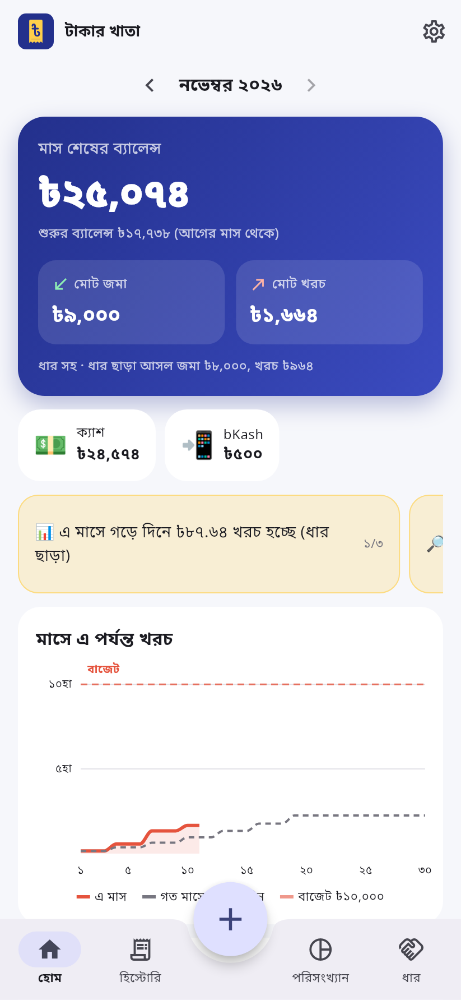
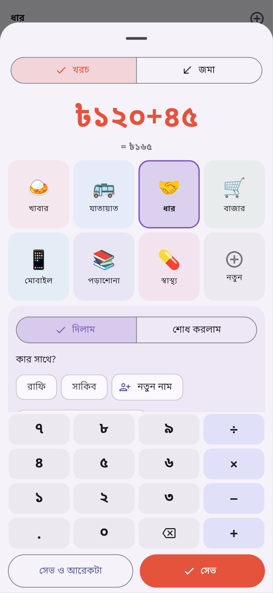
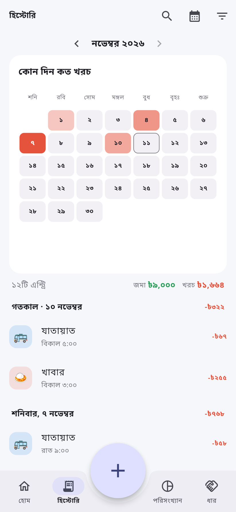
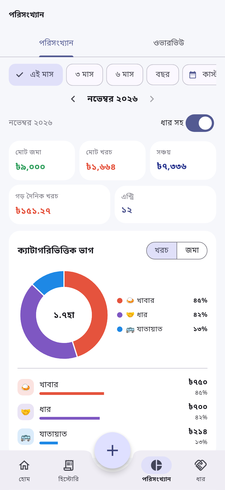
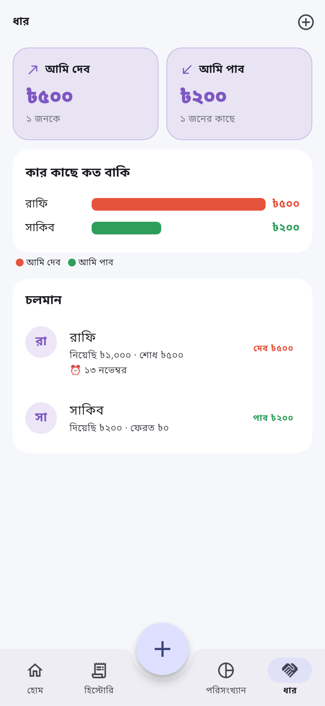
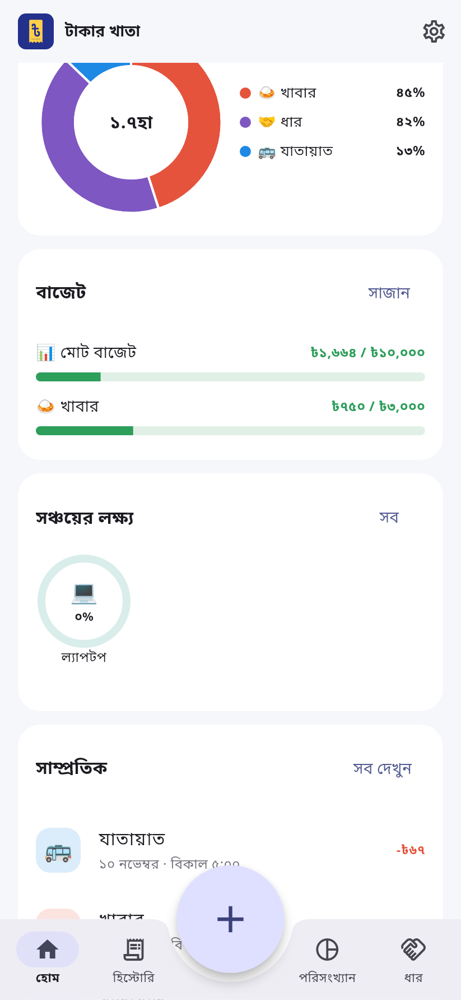
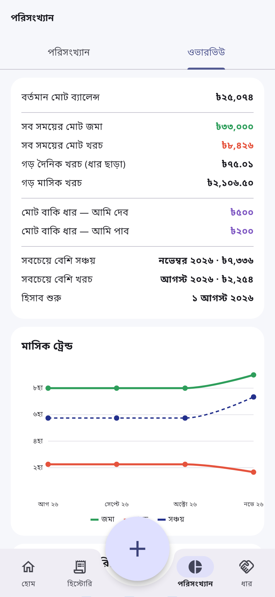
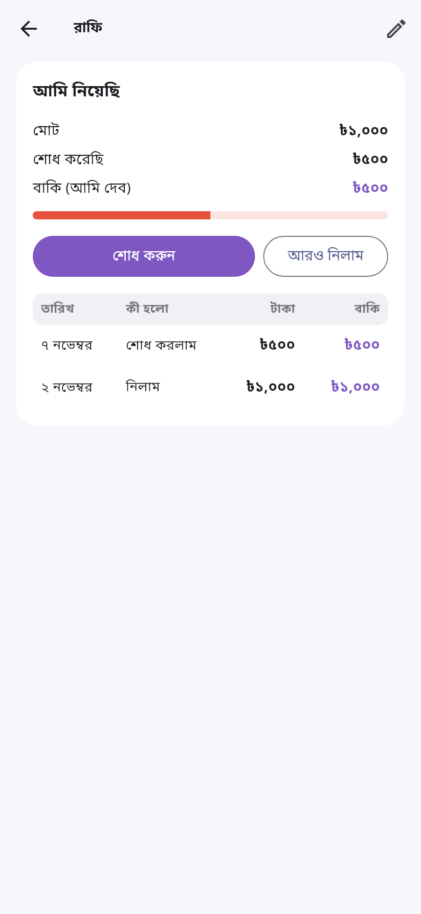
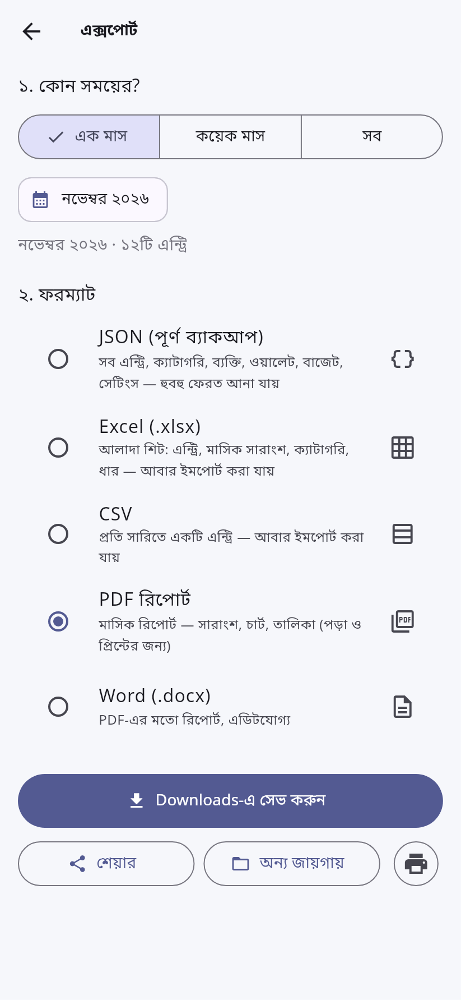
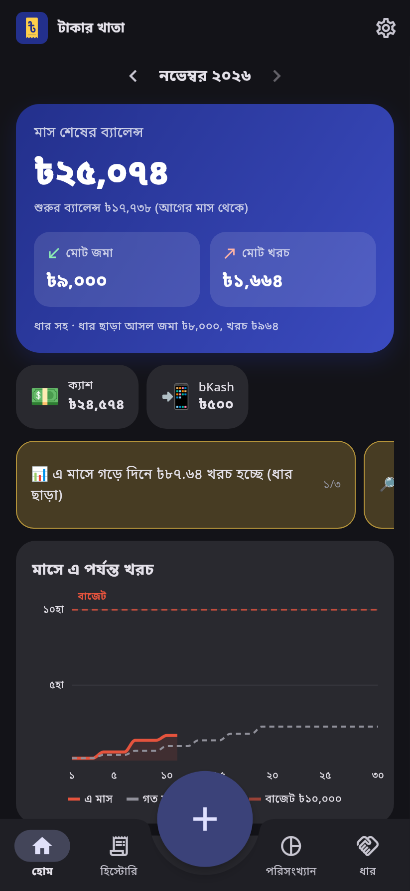

<p align="center">
  
</p>

<h1 align="center">টাকার খাতা</h1>

<p align="center">সম্পূর্ণ অফলাইন, ব্যক্তিগত Android অ্যাপ — দৈনিক খরচ, জমা আর ধারের মাসভিত্তিক হিসাব।<br>
কোনো সার্ভার, লগইন বা ইন্টারনেট লাগে না; সব ডাটা ফোনের ভেতরের SQLite ডাটাবেসে থাকে।</p>

| হোম | এন্ট্রি | হিস্টোরি | পরিসংখ্যান | ধার |
| --- | --- | --- | --- | --- |
|  |  |  |  |  |

| হোম (চার্ট) | ওভারভিউ | ব্যক্তির হিসাব | এক্সপোর্ট | ডার্ক থিম |
| --- | --- | --- | --- | --- |
|  |  |  |  |  |

পুরো পরিকল্পনা: [docs/proposal.md](docs/proposal.md)

## ফিচার

**দুই ভাষা — বাংলা ও English**
- প্রথমবার খুললে ভাষা বাছাই; পরে **সেটিংস → ভাষা / Language** থেকে যেকোনো সময় বদলানো যায়।
- সব স্ক্রিন, চার্ট, ইনসাইট, নোটিফিকেশন, হোম উইজেট, PDF/Word রিপোর্ট আর Excel/CSV হেডার নির্বাচিত ভাষায়।
- ভাষা বদলালে ডিফল্ট ক্যাটাগরি/ওয়ালেটের নামও বদলায় (খাবার ↔ Food); আপনার নিজের দেওয়া নাম যেমন আছে তেমন থাকে।
- বাংলায় ৳১,২৩৪, ইংরেজিতে ৳1,234 — চাইলে সংখ্যার ধরন আলাদা করেও বদলানো যায়।
- যেকোনো ভাষায় এক্সপোর্ট করা ফাইল অন্য ভাষার অ্যাপে ইমপোর্ট করা যায়।

**এন্ট্রি (৫ সেকেন্ডে)**
- মাঝের বড় **+** বাটন যেকোনো স্ক্রিন থেকে বটম শিট খোলে — উপরে খরচ · জমা।
- নিজস্ব নাম্বার প্যাড, সাথে ছোট ক্যালকুলেটর (`১২০+৪৫` → ৳১৬৫)।
- ৪ কলামে ইমোজি ক্যাটাগরির গ্রিড, বেশি ব্যবহৃতগুলো আগে; শেষ টাইল **+ নতুন** — শিট না ছেড়েই নতুন ক্যাটাগরি।
- তারিখ-সময় আপনাআপনি এখনকার; 'আজ' ও 'গতকাল' শর্টকাট।
- বিবরণ ও উদ্দেশ্য (আগে লেখা শব্দ থেকে সাজেশন), `#ট্যাগ`, রসিদের ছবি, ওয়ালেট।
- সেভে হালকা ভাইব্রেশন আর চেকমার্ক অ্যানিমেশন; **সেভ ও আরেকটা** দিয়ে একটানা অনেক এন্ট্রি।

**মাসিক ট্র্যাকার ও হিস্টোরি**
- ক্যালেন্ডার মাস (১ থেকে ৩০/৩১), `‹ নভেম্বর ২০২৬ ›` সুইচার।
- শুরুর ব্যালেন্স (আগের মাস থেকে ক্যারি), মোট জমা, মোট খরচ (ধার সহ), মাস শেষের ব্যালেন্স; ধার ছাড়া আসল আয়-খরচও।
- দিন অনুযায়ী গ্রুপ করা তালিকা, প্রতিদিনের মোট; টেক্সট সার্চ; ধরন, ক্যাটাগরি, ব্যক্তি, টাকার রেঞ্জ ও তারিখ দিয়ে ফিল্টার।
- যেকোনো লেনদেনে ট্যাপ করলে পূর্ণ বিবরণ (তারিখ-সময়, ক্যাটাগরি, ব্যক্তি, ওয়ালেট, বিবরণ, উদ্দেশ্য, ট্যাগ, রসিদ) — সেখান থেকে **এডিট** বা **ডিলিট**।
- প্রতিটি সারিতে ছোট ✏️ এডিট ও 🗑️ ডিলিট বাটন; ডিলিটের আগে নিশ্চিত করা হয়, পরে ৫ সেকেন্ডের Undo।

**ধার**
- 'ধার' খরচ-জমার ভেতরেই একটি ক্যাটাগরি — তাই মাসের মোট আর ব্যালেন্সে নিজে থেকেই যোগ হয়।
- খরচে **দিলাম / শোধ করলাম**, জমায় **নিলাম / ফেরত পেলাম**; ব্যক্তি বাছাই বা নতুন নাম।
- ধার পেজে 'আমি দেব' ও 'আমি পাব' কার্ড, ব্যক্তিভিত্তিক বার চার্ট, প্রত্যেকের মোট/শোধ/বাকি।
- ব্যক্তির পুরো হিস্টোরি (নতুনটা উপরে, প্রতি সারির পরে বাকি); সেখান থেকেই **শোধ করুন / ফেরত পেলাম** — বাকি টাকা আগে থেকে বসানো, আংশিকও দেওয়া যায়।
- বাকি শূন্য হলে 'মীমাংসিত' তালিকায়; ফেরত-তারিখে রিমাইন্ডার নোটিফিকেশন।

**ভিজ্যুয়ালাইজেশন** (fl_chart) — যেকোনো অংশে ট্যাপ করলে সেই অংশের এন্ট্রি
- ডোনাট (ক্যাটাগরির ভাগ), দৈনিক বার (গড়ের রেখা সহ), ক্রমযোজিত লাইন (বাজেট ও গত মাসের একই দিনের সাথে), মাসিক ট্রেন্ড (জমা/খরচ/সঞ্চয়), স্ট্যাকড বার (প্রতি মাসে ক্যাটাগরির ভাগ), স্ক্যাটার (দিনের সময় বনাম টাকা), ক্যালেন্ডার হিটম্যাপ, ব্যক্তিভিত্তিক বার।
- সময়ের রেঞ্জ: এই মাস, ৩ মাস, ৬ মাস, বছর, কাস্টম; 'ধার সহ / ধার ছাড়া' টগল।
- হোমে ইনসাইট কার্ড — যেমন "এ মাসে খাবারে গত মাসের এই সময়ের চেয়ে বেশি খরচ হচ্ছে"; সব হিসাব ফোনেই।

**এক্সপোর্ট, ইমপোর্ট ও ব্যাকআপ**

| ফরম্যাট | কী থাকে | আবার ইমপোর্ট? |
| --- | --- | --- |
| JSON (পূর্ণ ব্যাকআপ) | সব এন্ট্রি, ক্যাটাগরি (ইমোজি-রং সহ), ব্যক্তি, ওয়ালেট, ট্রান্সফার, বাজেট, লক্ষ্য, রিকারিং, সেটিংস | হ্যাঁ — হুবহু |
| Excel (.xlsx) | শিট: এন্ট্রি, মাসিক সারাংশ, ক্যাটাগরি, ধার | হ্যাঁ |
| CSV | প্রতি সারিতে একটি এন্ট্রি (UTF-8 BOM, Excel-এ বাংলা ঠিক দেখায়) | হ্যাঁ |
| PDF | মাসিক রিপোর্ট — সারাংশ, চার্ট, তালিকা, বাকি ধার | না |
| Word (.docx) | PDF-এর মতো রিপোর্ট, এডিটযোগ্য | না |

- এক্সপোর্টের আগে রেঞ্জ — এক মাস, কয়েক মাস বা সব; তারপর **Downloads-এ সেভ**, **শেয়ার**, **অন্য জায়গায় সেভ** বা (PDF) **প্রিন্ট**।
- ইমপোর্টে আগে প্রিভিউ (কত এন্ট্রি, কোন কোন মাস, কত ডুপ্লিকেট, কোন নতুন ক্যাটাগরি/ব্যক্তি), তারপর **মিলিয়ে যোগ করুন** (UUID দেখে ডুপ্লিকেট বাদ) অথবা **সব বদলে দিন** (আগে নিজে সুরক্ষা-ব্যাকআপ রাখে)। অজানা ক্যাটাগরি/ব্যক্তি নিজে তৈরি হয়। ID ছাড়া নিজে বানানো CSV-ও চলে (কলাম: `date, type, amount, category, note` বা বাংলা নাম)।
- **অটো ব্যাকআপ**: প্রতি সপ্তাহে বা মাস শেষে `Download/TakarKhata/backups/`-এ JSON, শেষ ১০টি রাখা হয় — অ্যাপ মুছে গেলে বা ফোন বদলালেও ফেরত আনা যায়।
- PDF-এর প্রতিটি পাতা Flutter দিয়ে আঁকা হয়ে ছবি হিসেবে বসে, তাই বাংলা যুক্তাক্ষর আর চার্ট হুবহু অ্যাপের মতো দেখায়।

**বাড়তি ফিচার**
- **প্রোফাইল**: নাম, মোবাইল, ইমেইল, পেশা, ঠিকানা আর ছবি (ক্যামেরা/গ্যালারি) — শুধু ফোনেই থাকে।
- **ওয়ালেট**: ক্যাশ, bKash, Nagad, ব্যাংক — আলাদা ব্যালেন্স; ট্রান্সফার খরচ হিসেবে গোনা হয় না।
- **মাসিক বাজেট**: মোট ও ক্যাটাগরিভিত্তিক; ৮০% আর ১০০% পার হলে লোকাল নোটিফিকেশন। যে মাসে সেট করবেন সেখান থেকে পরের সব মাসে প্রযোজ্য।
- **সঞ্চয়ের লক্ষ্য**: প্রগ্রেস রিং সহ।
- **রিকারিং এন্ট্রি**: মেস ভাড়া, ইন্টারনেট বিল — প্রতি মাসে নিজে থেকে যোগ হবে বা মনে করাবে।
- **অ্যাপ লক**: PIN (SHA-256 হ্যাশ) ও ফিঙ্গারপ্রিন্ট; ৩০ সেকেন্ডের বেশি বাইরে থাকলে আবার লক।
- **দৈনিক রিমাইন্ডার**: রাতে 'আজকের খরচ লিখেছেন?'
- **হোম স্ক্রিন উইজেট**: আজকের খরচ, এ মাসের খরচ আর দ্রুত যোগের **+** বাটন।
- **ট্যাগ**: `#ট্যুর` — এক ট্যাগের সব ক্যাটাগরির মোট এক জায়গায়।
- **রসিদের ছবি**: ক্যামেরা বা গ্যালারি থেকে, ফোনেই থাকে।
- Material 3, লাইট/ডার্ক থিম; খরচ লাল-কমলা, জমা সবুজ, ধার বেগুনি — সব স্ক্রিনে একই অর্থ। বাংলা সংখ্যা ও ৳ (সেটিংসে ইংরেজি সংখ্যা)।

## APK তৈরি

### GitHub থেকে (সবচেয়ে সহজ)
প্রতিটি push-এ GitHub Actions ([build-apk.yml](.github/workflows/build-apk.yml)) analyze, test চালিয়ে release APK বানায়।
Actions ট্যাবে রান খুলে **takar-khata-apk** আর্টিফ্যাক্ট নামিয়ে নিন। `v1.0.0` এর মতো ট্যাগ push করলে APK সহ একটি GitHub Release-ও তৈরি হয়।

### নিজের কম্পিউটারে
দরকার: Flutter 3.47 (stable), Android SDK, JDK 17+।

```bash
flutter pub get
```

```bash
flutter build apk --release
```

APK পাবেন `build/app/outputs/flutter-apk/app-release.apk`-এ। ডাটাবেস টেবিল বদলালে কোড আবার জেনারেট করুন:

```bash
dart run build_runner build
```

টেস্ট:

```bash
flutter test
```

> রিলিজ APK এখন ডিবাগ কী দিয়ে সাইন হয় (Flutter-এর ডিফল্ট)। Play Store-এ দিতে চাইলে `android/app/build.gradle.kts`-এ নিজের keystore যোগ করুন।

## টেক স্ট্যাক

| কাজ | প্যাকেজ |
| --- | --- |
| লোকাল ডাটাবেস | drift (SQLite) |
| স্টেট ম্যানেজমেন্ট | flutter_riverpod |
| চার্ট | fl_chart |
| Excel / CSV | excel, csv |
| PDF রিপোর্ট ও প্রিন্ট | pdf, printing |
| Word রিপোর্ট | নিজস্ব ছোট .docx নির্মাতা (archive) — টেমপ্লেট ফাইল লাগে না |
| ফাইল সেভ, বাছাই, শেয়ার | file_picker, share_plus, path_provider |
| নোটিফিকেশন | flutter_local_notifications, timezone, flutter_timezone |
| অ্যাপ লক | local_auth, crypto |
| ইমোজি পিকার | emoji_picker_flutter |
| রসিদের ছবি | image_picker |
| হোম স্ক্রিন উইজেট | home_widget |

## ডাটা মডেল

- `categories` — id, name, emoji, color, kind (০ খরচ / ১ জমা), sort_order, archived, is_debt
- `transactions` — id (UUID), type, amount (পয়সায়), category_id, debt_action (০ নিলাম / ১ শোধ / ২ দিলাম / ৩ ফেরত), person_id, wallet_id, occurred_at, note, purpose, photo_path, due_date, created_at, updated_at
- `persons` — id, name, phone, note
- `wallets` — id, name, emoji, opening_balance, sort_order, archived
- `transfers` — id (UUID), from_wallet_id, to_wallet_id, amount, occurred_at, note
- `budgets` — month (`YYYY-MM`), category_id (০ = মোট), limit_amount
- `goals`, `recurrings`, `settings` (key, value)

তিনটি মূল সিদ্ধান্ত: টাকা পয়সায় পূর্ণসংখ্যা (১২.৫০ ৳ = 1250); প্রতিটি এন্ট্রির UUID (ইমপোর্টে ডুপ্লিকেট ধরা); মাসিক মোট আলাদা টেবিলে নয় — এন্ট্রি থেকে গণনা, তাই পুরনো এন্ট্রি এডিট করলেও সব মাস নিজে থেকে ঠিক থাকে।

## ফোল্ডার কাঠামো

```
lib/
  main.dart, app.dart        অ্যাপ চালু, থিম, লক, স্টার্টআপ কাজ (রিকারিং, অটো ব্যাকআপ)
  providers.dart             Riverpod providers
  core/                      টাকা/সংখ্যা, তারিখ, ক্যালকুলেটর, থিম, i18n.dart (tr('বাংলা', 'English'))
  data/                      drift ডাটাবেস, ডিফল্ট ক্যাটাগরি, Repo
  domain/finance.dart        সব হিসাব: মাসিক সারাংশ, ধার, বাজেট, ইনসাইট, চার্টের ডাটা
  services/                  ব্যাকআপ, এক্সপোর্ট, ইমপোর্ট, PDF রিপোর্ট, নোটিফিকেশন, উইজেট
  ui/                        shell (ট্যাব), home, history, stats, debt, entry, manage, settings, widgets
android/app/src/main/kotlin  MainActivity, হোম স্ক্রিন উইজেট
test/                        ইউনিট, ডাটা (ইমপোর্ট/এক্সপোর্ট রাউন্ড-ট্রিপ) ও উইজেট টেস্ট
```

## ডেভেলপার


**Md. Abdul Mukit**
[mukit.swe.bd](https://mukit.swe.bd/) · [GitHub](https://github.com/abdullahalmukit) · [LinkedIn](https://www.linkedin.com/in/abdullah-al-mukit-12-12-2003-/) · [Facebook](https://www.facebook.com/abdulla.almukit.79)
যেকোনো প্রশ্ন বা যোগাযোগ: abdullahalmukit287@gmail.com
